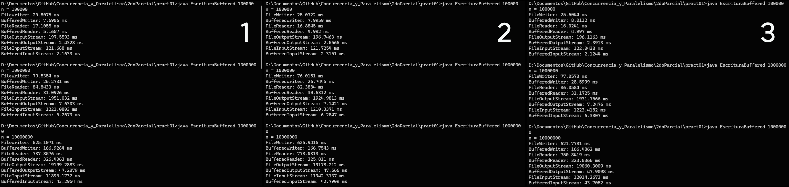

# Práctica 01: Medición de tiempo con flujos con y sin buffer

Alumno: Victor Adrian Romero Minaya - 67350
Fecha: 17/10/2026
Código: `EscrituraBuffered.java`

## Objetivo

Escribir y leer archivos de texto y binarios en Java con 8 flujos (4 sin buffer y 4 con buffer) y comparar cuánto tarda cada uno usando `System.nanoTime()`.

## Desarrollo

1. Creé `EscrituraBuffered.java` con un método para cada flujo.
2. En `main` definí `n` (la cantidad de elementos) y las rutas `archivo_salida.txt` y `archivo_salida.dat`. Para no recompilar cada vez, `n` también se puede pasar al ejecutar.
3. Cada método guarda `System.nanoTime()` al inicio, abre el flujo con `try-with-resources`, escribe o lee los `n` elementos y al final calcula el tiempo en milisegundos: `(fin - inicio) / 1_000_000.0`.
4. En texto se escribe `i + "\n"` (un número por línea). En binario se escribe `i` (1 byte por elemento).
5. Para leer usé `read()` de uno en uno, con y sin buffer, para que la comparación sea justa.
6. Compilé con `javac EscrituraBuffered.java` y ejecuté con `java EscrituraBuffered <n>`, 3 veces para n = 100,000, 1,000,000 y 10,000,000.
7. Saqué el promedio de cada flujo y armé las tablas.

## Resultados

### n = 100,000

| Flujo | Ejec. 1 (ms) | Ejec. 2 (ms) | Ejec. 3 (ms) | Promedio (ms) |
|---|---|---|---|---|
| FileWriter | 20.81 | 25.07 | 25.50 | 23.79 |
| BufferedWriter | 7.69 | 8.00 | 8.01 | 7.90 |
| FileReader | 17.11 | 16.88 | 16.02 | 16.67 |
| BufferedReader | 5.17 | 4.99 | 5.00 | 5.05 |
| FileOutputStream | 197.56 | 196.75 | 196.12 | 196.81 |
| BufferedOutputStream | 2.43 | 2.56 | 2.39 | 2.46 |
| FileInputStream | 121.69 | 121.73 | 122.04 | 121.82 |
| BufferedInputStream | 2.16 | 2.32 | 2.12 | 2.20 |

### n = 1,000,000

| Flujo | Ejec. 1 (ms) | Ejec. 2 (ms) | Ejec. 3 (ms) | Promedio (ms) |
|---|---|---|---|---|
| FileWriter | 79.54 | 76.02 | 77.06 | 77.54 |
| BufferedWriter | 26.27 | 26.74 | 28.60 | 27.21 |
| FileReader | 84.84 | 82.39 | 86.06 | 84.43 |
| BufferedReader | 31.09 | 30.63 | 31.17 | 30.97 |
| FileOutputStream | 1951.03 | 1924.98 | 1931.76 | 1935.92 |
| BufferedOutputStream | 7.63 | 7.14 | 7.25 | 7.34 |
| FileInputStream | 1221.08 | 1210.34 | 1223.42 | 1218.28 |
| BufferedInputStream | 6.27 | 6.28 | 6.38 | 6.31 |

### n = 10,000,000

| Flujo | Ejec. 1 (ms) | Ejec. 2 (ms) | Ejec. 3 (ms) | Promedio (ms) |
|---|---|---|---|---|
| FileWriter | 625.11 | 625.94 | 621.78 | 624.28 |
| BufferedWriter | 166.93 | 166.75 | 166.49 | 166.72 |
| FileReader | 737.86 | 778.43 | 750.84 | 755.71 |
| BufferedReader | 326.41 | 325.81 | 323.84 | 325.35 |
| FileOutputStream | 19199.29 | 19178.21 | 19060.30 | 19145.93 |
| BufferedOutputStream | 47.29 | 47.57 | 47.91 | 47.59 |
| FileInputStream | 11896.17 | 11942.37 | 12014.27 | 11950.94 |
| BufferedInputStream | 43.30 | 42.79 | 43.71 | 43.26 |

   

## Preguntas de análisis

**1. ¿Qué diferencia hay entre usar buffer y no usarlo? ¿Por qué pasa?**

Con buffer siempre salió más rápido. En los flujos de bytes la diferencia es enorme: con n = 10,000,000, `FileOutputStream` tardó unos 19 segundos y `BufferedOutputStream` unos 48 ms (como más de 400 veces menos :0). En lectura igual: `FileInputStream` ~11,951 ms contra `BufferedInputStream` ~43 ms. Por lo que vi pasa porque sin buffer cada `write(i)` o `read()` es una llamada al sistema operativo, y con 10 millones de elementos son 10 millones de llamadas. Con buffer los datos se juntan en memoria y se mandan al disco en bloques, así que hay muchas menos llamadas.

En texto pues la diferencia es menor, de unas 2 a 4 veces (por ejemplo `FileWriter` 624 ms contra `BufferedWriter` 167 ms). Esto se debe a que `FileWriter` y `FileReader` ya usan internamente un buffer pequeño para convertir caracteres a bytes, así que no hacen una llamada al disco por cada carácter :p

**2. ¿Cómo cambia el tiempo al aumentar n? ¿Es lineal? ¿Pasa igual en lectura y escritura?**

El tiempo sube al aumentar n en todos los flujos, pero no de la misma forma. Los de bytes sin buffer son casi lineales: `FileOutputStream` pasó de 197 a 1936 y a 19146 ms, es decir, 10 veces más tiempo cada vez que n se multiplica por 10. `FileInputStream` hace lo mismo (122, 1218 y 11951 ms). Los que usan buffer crecen menos que eso: `BufferedOutputStream` fue de 2.46 a 7.34 y a 47.59 ms, o sea unas 3 veces de 100,000 a 1,000,000 y unas 6.5 veces de 1,000,000 a 10,000,000. Probablemente porque con pocos datos pesa más el tiempo fijo de abrir y cerrar el archivo, pero eso no lo comprobé :)

Lectura y escritura se comportan parecido, aunque en binario sin buffer leer fue más rápido que escribir (11,951 ms contra 19,146 ms con n = 10,000,000). En texto pasó al revés: leer con `FileReader` (756 ms) tardó más que escribir con `FileWriter` (624 ms).

**3. ¿Hay diferencia entre trabajar con caracteres y con bytes? ¿A qué se debe?**

Sí. Vi que sin buffer, los bytes fueron mucho más lentos que el texto (con n = 10,000,000, `FileOutputStream` 19,146 ms contra `FileWriter` 624 ms), porque `FileWriter` tiene un buffer interno y `FileOutputStream` no. Con buffer pasa lo contrario: los bytes ganan (`BufferedOutputStream` 48 ms contra `BufferedWriter` 167 ms, y en lectura `BufferedInputStream` 43 ms contra `BufferedReader` 325 ms). Los flujos de caracteres tienen que codificar y decodificar según el charset, y además en texto cada elemento ocupa varios caracteres (un número como 9999999 más el salto de línea), mientras que en binario cada elemento es un solo byte. Por eso la comparación no es del todo pareja: el texto mueve más datos.

**4. ¿Qué tamaño tiene el buffer por defecto? ¿Se puede cambiar?**

Pues son 8192 en los cuatro, 8192 bytes en `BufferedOutputStream` y `BufferedInputStream`, y 8192 caracteres en `BufferedWriter` y `BufferedReader`. Sí se puede cambiar con el constructor que recibe el tamaño, por ejemplo `new BufferedOutputStream(fos, 65536)`.

**5. ¿Por qué `BufferedReader` tiene `readLine()` y `BufferedInputStream` no? ¿Qué implica al leer texto?** 

Porque `BufferedReader` trabaja con caracteres y en texto sí existe el concepto de línea (termina en un salto de línea). `BufferedInputStream` trabaja con bytes, que pueden ser una imagen, un audio o cualquier cosa, y ahí no hay líneas. Si se quiere leer texto con `BufferedInputStream` hay que buscar uno mismo el byte del salto de línea y convertir los bytes a texto, mientras que `readLine()` ya devuelve la línea completa como `String`.

## Conclusión

En conclusion entendi que usar buffer reduce las llamadas al disco y mejora el tiempo, sobre todo en binario cuando se escribe o lee byte por byte, donde en mis pruebas pasó de segundos a milisegundos. En texto la mejora es menor porque `FileWriter` y `FileReader` ya traen un buffer interno, pero aun así conviene usar `BufferedWriter` y `BufferedReader`, que además dan `readLine()`. Y ya para binario conviene `BufferedInputStream` y `BufferedOutputStream`. También hay que cerrar siempre los flujos con `try-with-resources` para que el buffer se vacíe al final y yap :D
